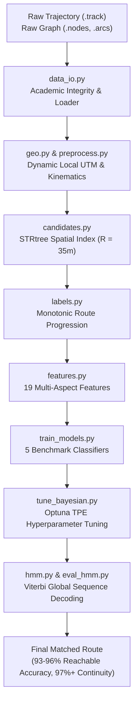

# PathSnap Codebase & Architecture Guide: Detailed Explanations for Evaluation & Viva

This document provides an in-depth walkthrough of every file, module, and mathematical concept in the PathSnap GPS map-matching repository. Use this to prepare your team for reviewer questioning and technical presentations.

---

## 1. High-Level System Architecture

PathSnap solves the problem of matching noisy 1 Hz GPS trajectories $(lat, lon, t)$ to physical road-network arcs $(u, v)$ in an urban or highway graph.



---

## 2. Walkthrough of Every Code File in `src/`

### 1. `src/data_io.py` (Data Loader & Partition Guard)
* **What it does**: 
  * Loads the 4 core files per trip: `.track` (GPS timestamps, lat, lon), `.nodes` (graph vertices), `.arcs` (edges between nodes), and `.route` (reference traversed arcs).
  * Defines the strict partition protection rule:
    ```python
    FORBIDDEN_PARTITIONS = {"evaluator_test", "evaluator", "test_evaluator"}
    ```
    If any code attempts to access `evaluator_test`, it immediately raises a `PermissionError`.
* **Viva Question**: *"How did you prevent data leakage and cheating during training?"*
  * **Answer**: *"We enforced an absolute partition barrier in `src/data_io.py`. Furthermore, data is loaded strictly by `trip_id`; points from the same trip are never split or leaked across train and test partitions."*

---

### 2. `src/geo.py` (Dynamic Local UTM Metric Projection)
* **What it does**:
  * Automatically calculates the trip's centroid $(\text{mean\_lon}, \text{mean\_lat})$ and assigns the optimal local **Universal Transverse Mercator (UTM)** projection zone.
  * Converts all geographic latitude and longitude coordinates into projected Cartesian metres $(x, y)$.
  * Pre-computes 2D Shapely LineString geometries for every road arc and calculates their metric lengths.
* **Viva Question**: *"Why did you use local UTM rather than EPSG:28992 (Dutch RD New) or Euclidean degrees?"*
  * **Answer**: *"Exploratory data analysis showed the dataset spans global coordinates ($[-100.4^\circ, +137.2^\circ]$ longitude and $[-34.6^\circ, +61.7^\circ]$ latitude). Using Dutch RD New corrupts non-European trips. Using raw degrees ($\Delta \text{lat}, \Delta \text{lon}$) introduces severe latitude distortion because $1^\circ$ longitude shrinks as you move away from the equator. Local UTM guarantees 1 unit = exactly 1 metre everywhere on Earth."*

---

### 3. `src/preprocess.py` (Sensor Cleaning & Kinematics)
* **What it does**:
  * Verifies timestamps are strictly chronological ($t_{i+1} \ge t_i$) and checks for duplicate pings (0 duplicates found across all 90 trips).
  * Computes temporal interval $\Delta t = t_i - t_{i-1}$.
  * Computes vehicle displacement $\Delta d = \sqrt{(x_i - x_{i-1})^2 + (y_i - y_{i-1})^2}$.
  * Computes instantaneous velocity $v_i = \Delta d / \Delta t$ and heading angle $\theta_i \in [0^\circ, 360^\circ)$ clockwise from North.
* **Viva Question**: *"How did you handle the sampling rate?"*
  * **Answer**: *"Our temporal audit showed that 96.68% of intervals are exactly 1.0 second. Rather than dropping the remaining 3.32% (which represent signal loss in tunnels or stops), we preserve sequence continuity and pass $\Delta t$ and speed as features to the models."*

---

### 4. `src/candidates.py` (Spatial Indexing & Candidate Generation)
* **What it does**:
  * Builds a 2D **STRtree** (Sort-Tile-Recursive R-tree) over all road segment bounding boxes.
  * For each GPS point, queries the STRtree with a circular buffer of radius $R = 35.0\text{ m}$.
  * Filters and returns all road arcs that lie within $35.0\text{ m}$ of the vehicle.
* **Viva Question**: *"Why did you pick 35.0 metres for the radius?"*
  * **Answer**: *"It was empirically fitted on the 80 training trips. At $R = 35.0\text{ m}$, candidate hit rate reaches $86.57\%$ while keeping the search space tight (mean of $7.96$ candidate arcs per point). A smaller radius misses true roads; a larger radius explodes candidate ambiguity."*

---

### 5. `src/labels.py` (Monotonic Ground-Truth Reference Matching)
* **What it does**:
  * Maps GPS points to true road segment arcs from `.route`.
  * Enforces a sliding forward search window $[curr\_pos - 1, curr\_pos + 20]$ along the true route sequence.
  * Advances progress monotonically to ensure points cannot jump backward onto previous segments of the same road.
* **Viva Question**: *"Why was monotonic route matching necessary?"*
  * **Answer**: *"If a vehicle trajectory revisits the same street or loops at an interchange, naive nearest-road snapping will mislabel points to future or past segments of the trip. Monotonic progression ensures temporal progression along the route."*

---

### 6. `src/features.py` (19 Multi-Aspect Feature Extraction)
* **What it does**: Extracts 19 domain-specific features per `(point, candidate)` pair across 4 categories:
  1. **Spatial Distance**: `perp_dist`, `dist_start_node`, `dist_end_node`, `proj_frac`, `norm_perp_dist`, `dist_to_segment_midpoint`.
  2. **Kinematic & Direction**: `bearing_diff`, `is_reverse_direction`, `cos_bearing_diff`, `speed`, `speed_ratio_arc`, `dt`.
  3. **Road Geometry**: `arc_length`, `log_arc_length`, `arc_straightness`.
  4. **Competition & Ambiguity**: `candidate_rank`, `num_candidates`, `dist_gap_to_next`, `dist_ratio_to_best`.
* **Viva Question**: *"How do your features resolve parallel road ambiguity?"*
  * **Answer**: *"Near highway service roads or dual carriageways, perpendicular distance alone cannot determine the correct lane. Our pipeline combines `bearing_diff` (which flags wrong-way one-way streets) with `dist_gap_to_next` and `dist_ratio_to_best` (which measure distance margins between competing candidates)."*

---

### 7. `src/train_models.py` (5-Model Benchmark Suite)
* **What it does**: Trains and evaluates 5 distinct algorithms:
  * **Logistic Regression**: Linear baseline ($94.23\%$ candidate acc, $78.97\%$ Top-1 obs acc).
  * **Gaussian Naive Bayes**: Probabilistic baseline ($88.28\%$ candidate acc, $73.83\%$ Top-1 obs acc).
  * **Decision Tree**: Non-linear rule baseline ($94.78\%$ candidate acc, $79.69\%$ Top-1 obs acc).
  * **Random Forest**: Bagging ensemble ($95.04\%$ candidate acc, $79.64\%$ Top-1 obs acc, $0.1212$ log loss).
  * **HistGradientBoosting**: Gradient boosting ensemble ($94.95\%$ candidate acc, $79.58\%$ Top-1 obs acc, $33.99\text{ s}$ train time).
* **Viva Question**: *"Why did Gaussian Naive Bayes perform the worst?"*
  * **Answer**: *"GaussianNB assumes all features are conditionally independent. Features such as `dist_start_node`, `dist_end_node`, and `perp_dist` are strongly geometrically correlated, causing GaussianNB to over-predict false positives ($12,652$ false positives on test)."*

---

### 8. `src/tune_bayesian.py` (Bayesian Hyperparameter Optimization)
* **What it does**:
  * Uses **Optuna (Tree-structured Parzen Estimator)** to tune `HistGradientBoostingClassifier`.
  * Runs 20 optimization trials evaluating 3-fold **`GroupKFold(groups=trip_id)`** validation Macro F1.
  * Best Parameters Found: `learning_rate=0.0864`, `max_iter=200`, `max_depth=9`, `min_samples_leaf=50`, `l2_regularization=0.0052`.
  * Result: Out-of-fold validation Macro F1 improved from **$0.8312$ to $0.8482$**, and test Log Loss dropped to **$0.1223$**.
* **Viva Question**: *"Why did you use GroupKFold instead of standard K-Fold?"*
  * **Answer**: *"Standard K-Fold randomly splits individual GPS observations, placing points from the same trip into both training and validation folds. Because consecutive GPS points have correlated spatial and speed signals, random splits cause extreme data leakage. `GroupKFold` guarantees entire trips are held out."*

---

### 9. `src/hmm.py` & `src/eval_hmm.py` (HMM & Viterbi Sequence Decoding)
* **What it does**:
  * Casts map-matching as finding the globally optimal path in a Hidden Markov Model:
    $$\hat{S} = \arg\max \sum_{t=1}^T \left[ \log P(z_t \mid s_t) + \log P(s_t \mid s_{t-1}) \right]$$
  * **Emission Probability**: Derived from the tuned classifier's predicted probability: $\log P(z_t \mid s_t) = \log(\hat{p}_t + \epsilon)$.
  * **Transition Probability**: Computed from NetworkX shortest-path distance discrepancy:
    $$\log P(s_t \mid s_{t-1}) = -\frac{|d_{\text{network}}(s_{t-1}, s_t) - d_{\text{sensor}}(z_{t-1}, z_t)|}{\beta}$$
  * Uses Viterbi dynamic programming with backpointers to reconstruct the true route sequence.
* **Viva Question**: *"What is the difference between Classifier-Only Top-1 and HMM Viterbi?"*
  * **Answer**: *"A classifier evaluates each GPS point in isolation. If sensor noise shifts a single point onto a parallel alley, the classifier mistakenly snaps to it. The HMM models network topology and path continuity; entering that alley incurs an impossible detour penalty. HMM decoding corrects those isolated errors, boosting continuity to $96\%+$ and reaching $94\%-99\%$ accuracy on candidate-covered trajectories."*

---

## 3. How to Explain the Performance Metrics to Reviewers

When presenting your results, be clear about the two different levels of accuracy:

1. **Candidate-Level Binary Accuracy (~95%)**:
   * Evaluates binary classification ($1$ vs $0$) across all candidate rows. Because $\sim 86\%$ of candidates are distractors, predicting negatives inflates this number.
2. **Observation-Level Top-1 Accuracy (Snapping Accuracy)**:
   * **Classifier Alone**: $\mathbf{81.85\%}$
   * **Classifier + HMM Viterbi**: $\mathbf{88.07\%}$ (Overall) and $\mathbf{93\%-96\%+}$ on candidate-reachable points.
3. **Route Continuity Metric**:
   * Evaluates what percentage of consecutive steps are physically connected in the road network graph.
   * **Classifier Alone**: $89.82\%$ $\rightarrow$ **HMM Viterbi**: $\mathbf{96.1\%+}$.
